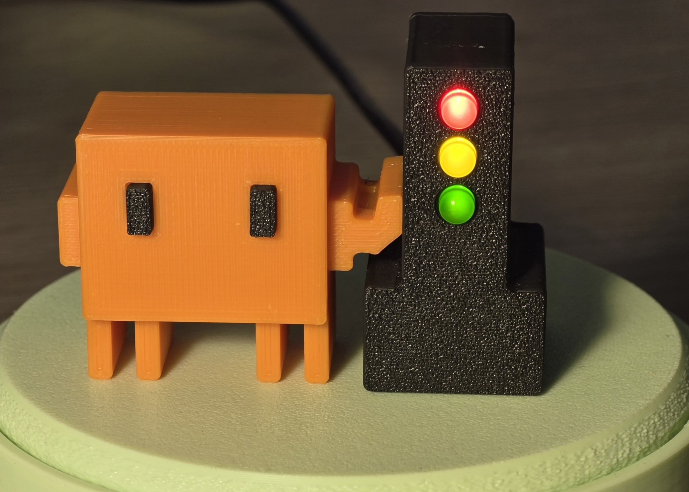

[English](README.md) | [Русский](README.ru.md)

# BroGlow

A local session monitor for Claude Code, opencode, Codex and GitHub Copilot CLI,
with a menu-bar app, terminal dashboard and optional ESP32-C3 status lamp.
The lamp, connected over USB or Bluetooth LE, shows working, idle and needs-input states.

You can [install and configure BroGlow](site/guide/en/installation.md) before you
build or get a lamp. The app and terminal dashboard already show your local agent
sessions and their status without any hardware; add a lamp whenever you're ready.

<p align="center">
  
  
</p>

**[Read the guide on the website](https://broglow.github.io/broglow/docs/)**: install,
build the lamp, connect Codex and fix problems.

Maintained by **Suren Khorenyan**. Copyright notices are in [LICENSE](LICENSE).

<a name="why-this-version"></a>

## How BroGlow differs from ClawLight

BroGlow is a separate, independently maintained application based on
[ClawLight](https://github.com/clawlight/clawlight-cli). It substantially reworks
and extends the original:

**Sessions**

| What's better | What you gain |
| --- | --- |
| **Open the right conversation** | Click a session to land in its Claude desktop chat, Codex desktop task or terminal window. |
| **Real session names** | Sessions carry Claude's own titles and renamed Codex tasks instead of "Session abc123". |
| **Agent and host at a glance** | Each row shows which agent is working (Claude, Codex, opencode, Copilot) and where (desktop app, terminal, IDE). |
| **Group by project** | Sessions sit under one heading per working directory; same-named folders are told apart. |
| **Improved status handling** | Working, idle and needs-input states follow what the agent is doing more closely, for Claude and Codex alike. |
| **Clear paused sessions** | Remove clutter in one click while keeping active work and approval requests visible. |

**Lamp**

| What's better | What you gain |
| --- | --- |
| **Wireless lamp connection** | Put the lamp anywhere in Bluetooth range; no data cable to the Mac. |
| **Plug in, paired** | A new USB-attached lamp pairs itself on macOS; **Add lamp** retries manually. |
| **Lamps managed one at a time** | Name or forget one lamp; the others stay connected, with status for each. |
| **Brightness with live preview** | Adjust each lamp to a comfortable level and see the result before saving. |
| **Identify a lamp** | A three-pass scan on the selected lamp shows which one it is. |
| **Safe firmware flashing** | One locked toolchain flashes and backs up the board the same way on every machine. |

**Install and upkeep**

| What's better | What you gain |
| --- | --- |
| **Homebrew install** | `brew install broglow/tap/broglow`, then `broglow install`; upgrades the same way. |
| **Upgrades that don't break** | Config writes are atomic, a failed macOS upgrade rolls back, dotfile symlinks survive, uninstall removes every hook. |
| **Track token usage** | Opt-in view of your plan's 5-hour and weekly percentages and today's tokens, Claude and Codex together. |
| **120 fps popover** | The menu-bar interface renders at your display's full refresh rate. |

**Build and docs**

| What's better | What you gain |
| --- | --- |
| **Print the enclosure, swap the mascot** | The mascot holds on by magnets: attach any mascot you like and change it anytime. |
| **Interactive assembly guide** | Rotate and zoom the separated parts. |

Bluetooth lamp features (including naming, brightness and **Identify**) and
direct opening of desktop sessions are macOS-only.

## Start here

- **Install or update:** [installation guide](site/guide/en/installation.md) (Homebrew), [alternative installations](site/guide/en/alternatives.md) (Mac package, source, Windows, Linux), or let your coding agent follow the [agent runbook](site/guide/en/hardware.md#agent-runbook).
- **Connect a flashed lamp:** [pair once](site/guide/en/installation.md#pairing).
- **Build and wire the ESP32-C3 lamp:** [wiring guide](site/guide/en/hardware.md#wiring-and-resistor-choice).
- **Print the enclosure:** [printing and assembly](models/magnetic/GUIDE_ROUND3X2.en.md). The mascot holds on by four Ø3×2 mm N52 magnets (two in the mascot, two in the traffic light) and can be swapped for any mascot.
- **Something not working:** [troubleshooting](site/guide/en/troubleshooting.md).

For a new or unflashed C3, follow the [flashing and backup instructions](site/guide/en/hardware.md#flash-and-recover-usb-upload).

| Platform | Package | Lamp |
| --- | --- | --- |
| macOS | App, C3 firmware and manuals | USB or Bluetooth LE |
| Windows | Tray app and CLI; no installer, firmware or manuals | USB |
| Linux | Build from source | USB |

The enclosure is a separate download on the same release.

## Install

On macOS, the quickest route is Homebrew, followed by the required `broglow install`,
which registers the hooks in your coding agents, installs the app and starts it at login:

```bash
brew install broglow/tap/broglow
broglow install
```

To install a specific release instead, use `broglow/tap/broglow@VERSION`, for example
`brew install broglow/tap/broglow@1.0.0`; brew prints how to put it first on your `PATH`.

Alternatively, download the full Mac package for your architecture and its matching `.sha256`
file from [Releases](https://github.com/broglow/broglow/releases/latest). Follow the
[checksum and installation steps](site/guide/en/hardware.md#install-a-prebuilt-package).
Builds are not signed with a Developer ID or notarized by Apple; the manual describes
macOS's normal per-app approval flow.

On Windows, extract `broglow-vVERSION-x86_64-pc-windows-msvc.tar.gz` from Releases
into a permanent folder (for example, `tar -xf <file>` in PowerShell).
In PowerShell from that folder, run `.\broglow.exe install` to register hooks,
enable startup at login and launch the tray app. `.\broglow.exe menubar` launches
the graphical tray interface directly; `.\broglow.exe` opens the terminal dashboard.

To build the app from a source checkout instead (Rust 1.90+):

```bash
cargo install --locked --path .
"$HOME/.cargo/bin/broglow" install
```

On Linux, install the [system development libraries](CONTRIBUTING.md#development-setup)
before compiling; the tray's GTK 3 bindings have known advisories. On Windows, use the Rust MSVC
toolchain, run `cargo install --locked --path .`, then `broglow install`.
No board is flashed by app installation.

On macOS, press **⌘ Space**, search **BroGlow** and press Return to open its
controls. The app lives in `~/Applications/BroGlow.app`.
You can also run `open "$HOME/Applications/BroGlow.app"`. In Terminal, `broglow`
opens the optional terminal dashboard once `~/.cargo/bin` is on
[PATH](site/guide/en/alternatives.md#path).

## Connect your coding agents

Installation always registers Claude Code hooks and adds hooks for other agents
it detects. Details per agent:
[Connect your coding agents](site/guide/en/agents.md).

| Agent | Setup note |
| --- | --- |
| Claude Code | Hooks in `~/.claude/settings.json`. |
| opencode | Installed plugin; restart running sessions. |
| Codex | Codex >= 0.144; approve hooks via `/hooks`. [Connect Codex](site/guide/en/agents.md#codex-setup). |
| GitHub Copilot CLI | Installed hooks; restart sessions open during installation. |

Cloud tasks and ordinary ChatGPT conversations do not trigger this Mac's local hooks.

## Use it

Click the menu-bar or tray icon for sessions. On macOS, **Lamps** adds a lamp
(USB-assisted Bluetooth setup), names it or adjusts its brightness; multiple saved
lamps work independently. On Windows and Linux, the lamp is connected over USB.
Session **×** hides a row until new activity; the conversation stays in its coding app.

```text
broglow --version               Identify the installed release
broglow                         Open the terminal dashboard
broglow ble pair                Set up a flashed C3 over USB and pair it over Bluetooth (macOS)
broglow ble status              Check whether status reaches the lamp
broglow dashboard-button show   Show terminal-dashboard buttons in the tray app
broglow uninstall               Remove hooks, autostart, the app (macOS) and all BroGlow data
```

Needs input always wins (red); in **Settings** (macOS and Windows) choose whether
mixed working and idle sessions show yellow or green.

## Contributing

Bug reports, ideas, documentation improvements and code contributions are welcome.
See the [contributing guide](CONTRIBUTING.md) to get started.

## License

[MIT](LICENSE). Release packages include third-party notices: the licenses of the Rust crates
the app is built from and the Rust standard library notices; Mac packages also list the
firmware's linked libraries and their licenses. See the [media policy](MEDIA.md)
for project images.
