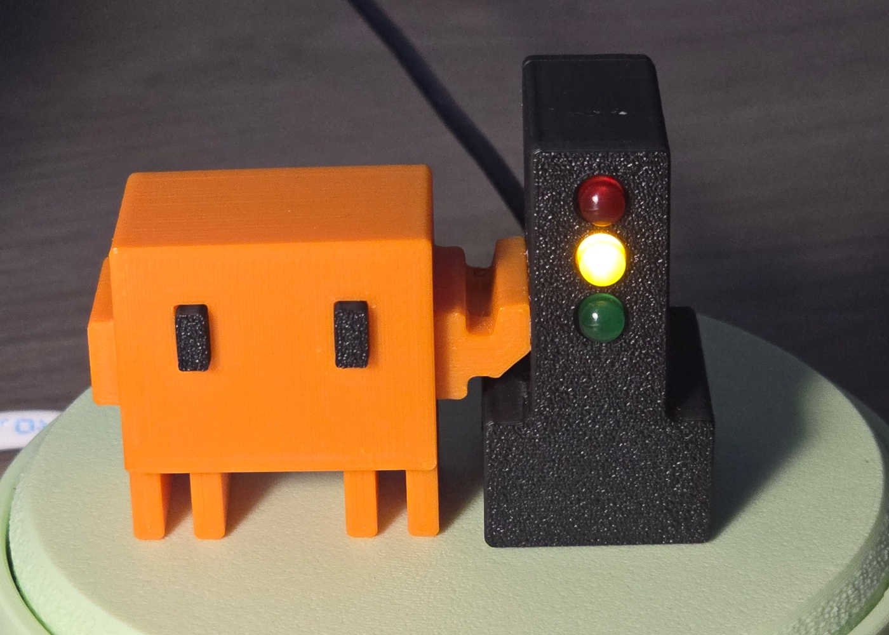
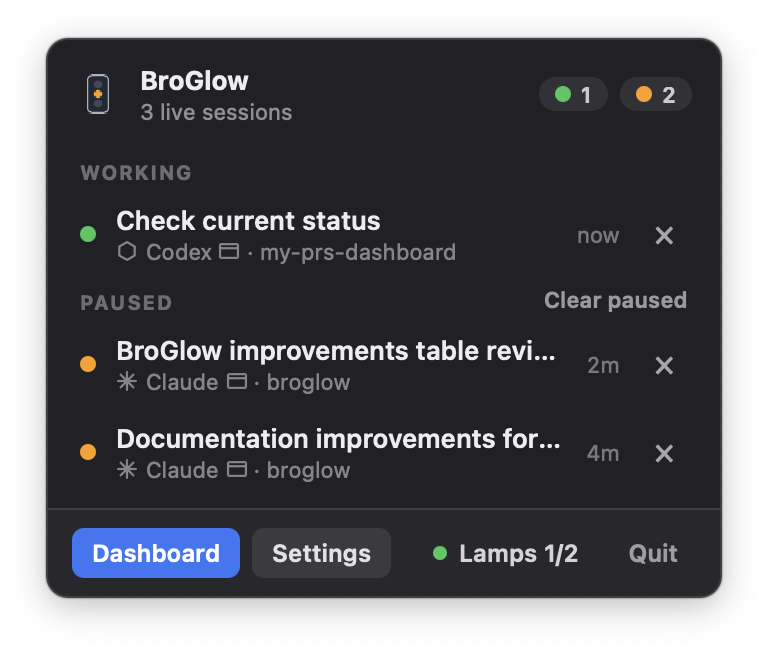

[English](README.md) | [Русский](README.ru.md)

<a name="broglow"></a>

# BroGlow

Монитор локальных сессий Claude Code, opencode, Codex и GitHub Copilot CLI
с приложением в строке меню, терминальной панелью и необязательной лампой ESP32-C3.
Лампа, подключённая по USB или Bluetooth LE, показывает работу, ожидание и запрос ввода.

<p align="center">
  
  
</p>

**[Руководство на сайте](https://broglow.github.io/broglow/docs/ru/)**: установка,
сборка лампы, подключение Codex и решение проблем.

Проект поддерживает **Suren Khorenyan**. Уведомления об авторских правах — в [LICENSE](LICENSE).

<a name="why-this-version"></a>

## Чем BroGlow отличается от ClawLight

BroGlow — отдельное, независимо поддерживаемое приложение на основе
[ClawLight](https://github.com/clawlight/clawlight-cli). В нём существенно
переработаны и расширены возможности оригинала:

**Сессии**

| Что улучшилось | Что это даёт вам |
| --- | --- |
| **Открытие нужного разговора** | Нажмите на сессию, чтобы попасть в её чат Claude, задачу Codex или окно терминала. |
| **Настоящие названия сессий** | Сессии показывают собственные заголовки Claude и переименованные задачи Codex вместо «Session abc123». |
| **Агент и хост с первого взгляда** | В каждой строке видно, какой агент работает (Claude, Codex, opencode, Copilot) и где (приложение, терминал, IDE). |
| **Группировка по проектам** | Сессии собраны под заголовком своей рабочей директории; одноимённые папки различаются. |
| **Улучшенная обработка статусов** | Состояния «работает», «ждёт» и «нужен ответ» точнее следуют за действиями агента — и для Claude, и для Codex. |
| **Очистка приостановленных сессий** | Уберите лишнее одним нажатием: работающие сессии и запросы разрешений останутся видимыми. |

**Лампа**

| Что улучшилось | Что это даёт вам |
| --- | --- |
| **Беспроводное подключение** | Ставьте лампу где угодно в зоне Bluetooth — кабель данных к Mac не нужен. |
| **Подключили — и готово** | Новая лампа по USB настраивается на macOS сама; **Добавить лампу** — ручной повтор. |
| **Управление каждой лампой отдельно** | Назовите или забудьте одну лампу — остальные останутся подключёнными, у каждой свой статус. |
| **Предпросмотр яркости** | Выберите комфортную яркость для каждой лампы и оцените результат до сохранения. |
| **Поиск нужной лампы** | Выбранная лампа трижды перебирает цвета — видно, какая это. |
| **Безопасная прошивка** | Один зафиксированный набор инструментов прошивает и бэкапит плату одинаково на любой машине. |

**Установка и обновление**

| Что улучшилось | Что это даёт вам |
| --- | --- |
| **Установка через Homebrew** | `brew install broglow/tap/broglow`, затем `broglow install`; обновления тем же путём. |
| **Обновления без поломок** | Настройки пишутся атомарно, неудачное обновление на macOS откатывается, симлинки dotfiles сохраняются, удаление убирает все хуки. |
| **Учёт расхода токенов** | Опциональный показ 5-часового и недельного лимита плана в процентах и токенов за сегодня — Claude и Codex вместе. |
| **Поповер на 120 fps** | Интерфейс в строке меню рисуется с полной частотой вашего дисплея. |

**Сборка и документация**

| Что улучшилось | Что это даёт вам |
| --- | --- |
| **Печать корпуса и смена маскота** | Маскот держится на магнитах: поставьте любого маскота и меняйте его когда угодно. |
| **Интерактивное руководство по сборке** | Вращайте и приближайте разнесённые детали. |

Функции Bluetooth-ламп (в том числе имена, яркость и **Identify**) и прямое
открытие сессий настольных приложений работают только на macOS.

<a name="start-here"></a>

## Начните здесь

- **Установка или обновление:** [руководство по установке](site/guide/ru/installation.md) (Homebrew), [другие способы установки](site/guide/ru/alternatives.md) (пакет для Mac, исходники, Windows, Linux) или поручите настройку coding-агенту по [инструкции для агента](site/guide/ru/hardware.md#agent-runbook).
- **Подключение прошитой лампы:** [сопряжение](site/guide/ru/installation.md#pairing).
- **Сборка и подключение лампы ESP32-C3:** [схема подключения](site/guide/ru/hardware.md#wiring-and-resistor-choice).
- **Печать корпуса:** [печать и сборка](models/magnetic/GUIDE_ROUND3X2.md). Маскот держится на четырёх магнитах Ø3×2 мм N52 (два в маскоте, два в светофоре), и его можно заменить на любого другого.
- **Что-то не работает:** [решение проблем](site/guide/ru/troubleshooting.md).

Для новой или непрошитой C3 следуйте [инструкции по прошивке и резервному копированию](site/guide/ru/hardware.md#flash-and-recover-usb-upload).

| Платформа | Пакет | Лампа |
| --- | --- | --- |
| macOS | Приложение, прошивка C3 и руководства | USB или Bluetooth LE |
| Windows | Приложение в трее и CLI; без установщика, прошивки и руководств | USB |
| Linux | Сборка из исходников | USB |

Корпус скачивается отдельным архивом из того же релиза.

<a name="install"></a>

## Установка

На macOS быстрее всего через Homebrew, затем обязательный `broglow install`: он
регистрирует хуки в ваших coding-агентах, устанавливает приложение и включает его
запуск при входе:

```bash
brew install broglow/tap/broglow
broglow install
```

Либо скачайте полный пакет для архитектуры вашего Mac и соответствующий файл
`.sha256` в разделе [Releases](https://github.com/broglow/broglow/releases/latest).
Следуйте [инструкции по проверке контрольной суммы и установке](site/guide/ru/hardware.md#install-a-prebuilt-package).
Сборки не подписаны Developer ID и не нотаризованы Apple; руководство описывает
обычную процедуру разрешения запуска отдельного приложения в macOS.

На Windows распакуйте `broglow-vVERSION-x86_64-pc-windows-msvc.tar.gz` из Releases
в постоянную папку (например, командой `tar -xf <файл>` в PowerShell).
Откройте PowerShell в этой папке и выполните `.\broglow.exe install`, чтобы
зарегистрировать хуки, включить автозапуск при входе и запустить приложение в трее.
`.\broglow.exe menubar` запускает графический интерфейс в трее напрямую;
`.\broglow.exe` открывает терминальную панель.

Чтобы вместо этого собрать приложение из исходников (нужен Rust 1.90+):

```bash
cargo install --locked --path .
"$HOME/.cargo/bin/broglow" install
```

На Linux перед компиляцией установите [системные библиотеки разработки](CONTRIBUTING.ru.md#development-setup);
у привязок GTK 3 для трея есть известные предупреждения безопасности.
На Windows используйте набор инструментов Rust MSVC, выполните `cargo install --locked --path .`,
затем `broglow install`.
Установка приложения не прошивает плату.

На macOS нажмите **⌘ Space**, найдите **BroGlow** и нажмите Return, чтобы открыть
управление. Приложение находится в `~/Applications/BroGlow.app`.
Также можно выполнить `open "$HOME/Applications/BroGlow.app"`.
Команда `broglow` в Terminal открывает необязательную терминальную панель, если
`~/.cargo/bin` есть в [PATH](site/guide/ru/alternatives.md#path).

<a name="connect-your-coding-agents"></a>

## Подключение агентов

Установка всегда регистрирует хуки Claude Code и добавляет хуки для других
обнаруженных агентов.
Подробности по каждому агенту: [Подключите coding-агентов](site/guide/ru/agents.md).

| Агент | Особенности настройки |
| --- | --- |
| Claude Code | Хуки в `~/.claude/settings.json`. |
| opencode | Устанавливается плагин; перезапустите работающие сессии. |
| Codex | Codex >= 0.144; одобрите хуки через `/hooks`. [Подключение Codex](site/guide/ru/agents.md#codex-setup). |
| GitHub Copilot CLI | Устанавливаются хуки; перезапустите сессии, открытые во время установки. |

Облачные задачи и обычные разговоры в ChatGPT не вызывают локальные хуки на этом Mac.

<a name="use-it"></a>

## Использование

Значок в строке меню или в трее открывает список сессий. На macOS раздел **Lamps**
добавляет лампу (настройка Bluetooth через USB), задаёт ей имя и яркость; сохранённые
лампы работают независимо. На Windows и Linux лампа подключается по USB.
Кнопка **×** скрывает сессию до новой активности; разговор остаётся в приложении агента.

```text
broglow --version               Узнать установленный релиз
broglow                         Открыть терминальную панель
broglow ble pair                Настроить прошитую C3 через USB и выполнить сопряжение по Bluetooth (macOS)
broglow ble status              Показать, доходят ли статусы до лампы
broglow dashboard-button show   Показать в приложении кнопки терминальной панели
broglow uninstall               Удалить хуки, автозапуск, приложение (macOS) и все данные BroGlow
```

Запрос ввода всегда имеет приоритет (красный); в **Settings** (macOS и Windows) можно
выбрать, каким цветом — жёлтым или зелёным — показывать состояние, когда одни сессии
работают, а другие ждут.

<a name="contributing"></a>

## Участие в проекте

Будем рады сообщениям об ошибках, идеям, улучшениям документации и кода.
Начните с [руководства для участников](CONTRIBUTING.ru.md).

<a name="license"></a>

## Лицензия

[MIT](LICENSE). Пакеты релиза содержат уведомления о сторонних компонентах: лицензии Rust-крейтов,
из которых собрано приложение, и уведомления стандартной библиотеки Rust; пакеты для Mac также
перечисляют скомпонованные библиотеки прошивки и их лицензии. Для иллюстраций действуют
[правила работы с изображениями](MEDIA.ru.md).
